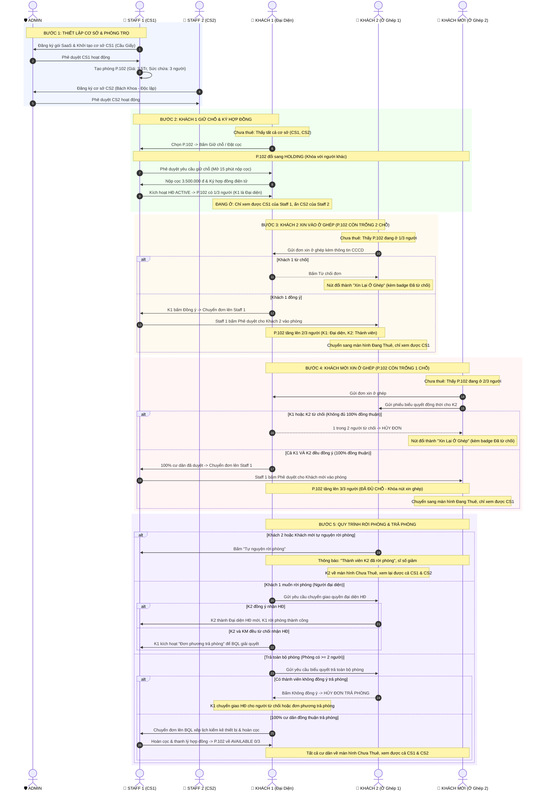
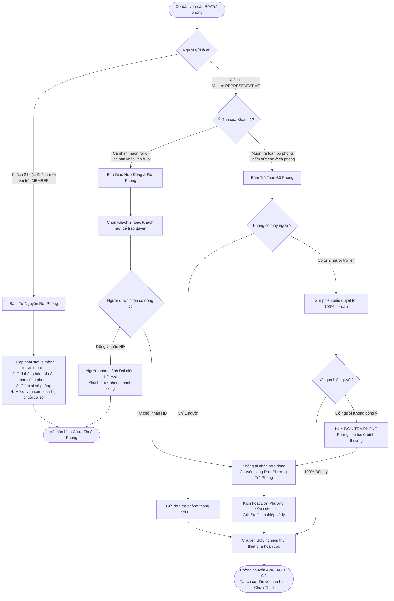

# TÀI LIỆU ĐẶC TẢ LUỒNG HOẠT ĐỘNG TOÀN DIỆN HỆ THỐNG TRỌ VIỆT SAAS
*(Chuẩn hóa 100% nghiệp vụ cho 1 Admin, 2 Staff, 3 Khách thuê - Hướng dẫn chi tiết cho AI & Developer)*

---

## 1. TỔNG QUAN HỆ THỐNG & CÁC VAI TRÒ THAM GIA

Hệ thống được vận hành bởi 6 chủ thể độc lập trên nền tảng SaaS tập trung:

| STT | Chủ thể (Actor) | Tên đại diện | Trách nhiệm chính trong kịch bản |
|:---:|:---|:---|:---|
| 1 | **Admin** | Hệ thống / Quản trị viên | Phê duyệt cơ sở nhà trọ của Staff, quản trị gói dịch vụ SaaS |
| 2 | **Staff 1** | Lê Thị Thu Ngân (CS1 - Cầu Giấy) | Đăng ký gói SaaS, tạo cơ sở CS1, tạo phòng P.102, duyệt giữ chỗ/thuê phòng, duyệt cư dân vào ở ghép, nghiệm thu trả phòng |
| 3 | **Staff 2** | Đàm Văn Thắng (CS2 - Bách Khoa) | Quản lý chuỗi cơ sở độc lập CS2, cung cấp danh mục phòng thuộc chuỗi cho khách tự do khám phá |
| 4 | **Khách 1** | Nguyễn Văn An | Khách thuê chính: Giữ chỗ $\rightarrow$ nộp cọc $\rightarrow$ ký hợp đồng điện tử $\rightarrow$ trở thành Đại diện HĐ phòng P.102. Biểu quyết duyệt Khách 2 và Khách mới vào ở ghép; bàn giao HĐ khi rời |
| 5 | **Khách 2** | Phạm Minh Cường | Thành viên ở ghép thứ nhất: Nộp đơn xin vào P.102 (chờ Khách 1 duyệt $\rightarrow$ Staff duyệt). Biểu quyết khi có Khách mới xin vào; rời phòng tự do |
| 6 | **Khách mới** | Hoàng Văn Nam | Thành viên ở ghép thứ hai: Nộp đơn xin vào P.102 (chờ cả Khách 1 VÀ Khách 2 cùng duyệt $\rightarrow$ Staff duyệt). Rời phòng tự do |

---

## 2. NGUYÊN TẮC CỐT LÕI (CORE BUSINESS RULES)

### Quy tắc 1: Cô lập phạm vi hiển thị cơ sở & phòng (Visibility Scope Isolation)
* **Khi đang giữ chỗ, đang trong thời gian nộp cọc, hoặc đang ở phòng:**
  * Khách **CHỈ ĐƯỢC NHÌN THẤY** các cơ sở và danh sách phòng thuộc chính Chủ trọ (Staff) mà mình đang liên kết.
  * Toàn bộ cơ sở/phòng của các Staff khác bị ẩn để tránh nhầm lẫn dữ liệu và bảo mật thông tin nội bộ chuỗi.
* **Khi chưa thuê phòng nào, hoặc sau khi rời phòng / trả phòng:**
  * Khách chuyển ngay về trạng thái "Chưa thuê phòng" (Cổng khách tiềm năng).
  * Bên trang *"Phòng Thuộc Chuỗi Chủ Trọ"*, khách được tự do tra cứu, xem tất cả cơ sở và phòng của **TẤT CẢ các Staff (Staff 1, Staff 2,...)**.

### Quy tắc 2: Đồng bộ trạng thái Giữ chỗ / Đặt cọc theo thời gian thực (Holding Broadcast)
* Khi một khách bấm giữ chỗ hoặc bắt đầu đặt cọc 1 phòng:
  * Phòng đó chuyển sang trạng thái `HOLDING` (có đếm ngược 15 phút).
  * **Với người đang giữ chỗ:** Hiển thị hướng dẫn nộp cọc, đồng hồ đếm ngược giữ phòng, nút *"Tiếp tục nộp cọc & ký HĐ"*.
  * **Với tất cả người khác:** Thấy rõ badge `Đang có người giữ chỗ đặt cọc`, nút thuê/xin ở ghép bị vô hiệu hóa (disabled) để chống trùng phòng.

### Quy tắc 3: Biểu quyết dân chủ khi xin vào ở ghép (Consensus Roommate Flow)
* **Phòng đang có 1 người (Khách 1):** Cần Khách 1 đồng ý $\rightarrow$ Chuyển đơn lên Staff 1 phê duyệt.
* **Phòng đang có 2 người (Khách 1 & Khách 2):** Khách mới nộp đơn $\rightarrow$ Cần **100% cư dân (cả Khách 1 VÀ Khách 2)** đồng thuận.
* **Xử lý từ chối:** Nếu có bất kỳ ai từ chối, đơn lập tức bị hủy (`REJECTED_BY_ROOMMATES`). Bên phía khách nộp đơn, nút trên card phòng tự động đổi thành **"Xin Lại Ở Ghép"** kèm nhãn *"Đã từng bị từ chối"* (thay vì nút "Xin vào ở ghép" như phòng mới) để khách dễ nhận biết và cập nhật lời giới thiệu chi tiết hơn.

### Quy tắc 4: Phân quyền Rời phòng (Leave Room)
* **Khách ở ghép (Khách 2, Khách mới):** Được quyền tự nguyện rời phòng bất kỳ lúc nào (`LEAVE_ROOM`). Sau khi rời, phòng gửi thông báo biến động cư dân cho các bạn còn lại, sĩ số phòng giảm đi 1, người rời chuyển về màn hình chưa thuê.
* **Khách đại diện hợp đồng (Khách 1):** KHÔNG ĐƯỢC tự ý rời phòng bỏ mặc hợp đồng. Khách 1 bắt buộc phải **chọn 1 bạn cùng phòng để bàn giao quyền đại diện HĐ**.
  * Nếu bạn cùng phòng đồng ý nhận HĐ: Người đó trở thành Đại diện HĐ mới, Khách 1 rời phòng thành công.
  * Nếu tất cả bạn cùng phòng từ chối nhận HĐ: Khách 1 chuyển sang luồng **Đơn phương trả phòng**.

### Quy tắc 5: Quy trình Trả toàn bộ phòng (Return / Full Room Checkout)
* **Nếu phòng chỉ có 1 người:** Gửi đơn trả phòng trực tiếp cho Ban Quản Lý (BQL) nghiệm thu và hoàn cọc.
* **Nếu phòng có từ 2 người trở lên:**
  * Hệ thống gửi phiếu biểu quyết tới **TẤT CẢ mọi người trong phòng**.
  * **100% đồng ý:** Đơn chuyển sang BQL để xếp lịch nghiệm thu phòng, chốt chỉ số điện nước và hoàn cọc.
  * **Có người không đồng ý:** Đơn trả phòng bị HỦY để bảo vệ quyền lợi cư dân đang ở. Người đại diện có thể yêu cầu người từ chối tiếp nhận hợp đồng; nếu người từ chối không nhận hợp đồng và cũng không chịu trả phòng, người đại diện có quyền kích hoạt **Đơn phương trả phòng** để BQL can thiệp.

---

## 3. SƠ ĐỒ TUẦN TỰ TỔNG THỂ (SEQUENCE DIAGRAM)

---

## 4. CHI TIẾT CÁC LUỒNG THỰC THI (USER FLOWS)

### FLOW 1: Khách 1 Thuê phòng & Kích hoạt Hợp đồng
1. **Tìm kiếm:** Khách 1 (chưa thuê phòng) vào màn hình *Phòng Thuộc Chuỗi*, thấy cả Cơ sở 1 (Cầu Giấy) và Cơ sở 2 (Bách Khoa).
2. **Giữ chỗ:** Khách 1 chọn phòng P.102 tại CS1 $\rightarrow$ Bấm *"Thuê Ngay / Giữ Chỗ"*.
3. **Phòng khóa:** P.102 chuyển trạng thái `HOLDING` (đồng hồ 15 phút kích hoạt). Tất cả khách khác nhìn thấy badge `Đang có người giữ chỗ đặt cọc`.
4. **Staff duyệt:** Staff 1 vào modal *Xét Duyệt Đơn Từ Cư Dân* $\rightarrow$ Bấm *Duyệt Giữ Chỗ*.
5. **Nộp cọc & Ký HĐ:** Khách 1 thấy cổng nộp cọc mở ra $\rightarrow$ Xác nhận nộp cọc 3.500.000 đ $\rightarrow$ Ký hợp đồng điện tử bằng chữ ký số OTP/CCCD.
6. **Kích hoạt:** Hợp đồng chuyển thành `ACTIVE`.
   * P.102 có sĩ số: **1/3 người (Còn trống 2 chỗ)**.
   * Khách 1 được cấp vai trò `REPRESENTATIVE` (Đại diện HĐ).
   * Khách 1 chuyển sang màn hình Cư Dân Đang Thuê: **Chỉ xem được CS1 của Staff 1, ẩn CS2 của Staff 2**.

---

### FLOW 2: Khách 2 Xin vào Ở ghép (Phòng đang 1 người)
1. **Khám phá:** Khách 2 vào hệ thống, thấy P.102 đang ở `1/3 người` kèm nút **"Xin Vào Ở Ghép"**.
2. **Gửi đơn:** Khách 2 nhập CCCD, số điện thoại, quê quán và lời giới thiệu bản thân $\rightarrow$ Bấm gửi đơn.
3. **Biểu quyết cư dân:**
   * Khách 1 nhận thông báo có đơn xin ở ghép mới kèm nút *Xem & Biểu quyết*.
   * **Trường hợp Khách 1 Từ chối:** Đơn chuyển sang `REJECTED_BY_ROOMMATES`. Bên Khách 2, nút phòng chuyển thành **"Xin Lại Ở Ghép"** kèm badge *"Đã từng bị từ chối"*. Khi bấm lại, modal hiển thị lưu ý cập nhật lời giới thiệu chi tiết hơn.
   * **Trường hợp Khách 1 Đồng ý:** Đơn chuyển trạng thái sang `ROOMMATES_APPROVED` $\rightarrow$ Chuyển tiếp lên Staff 1.
4. **Staff 1 phê duyệt:** Staff 1 kiểm tra hồ sơ $\rightarrow$ Bấm *Phê Duyệt*.
5. **Kết quả:**
   * Sĩ số phòng P.102 tăng lên: **2/3 người (Còn trống 1 chỗ)**.
   * Danh sách cư dân hiển thị đủ cả 2 người:
     * Nguyễn Văn An (`🔑 Đại Diện Ký Hợp Đồng`)
     * Phạm Minh Cường (`👤 Thành Viên Ở Ghép`)
   * Khách 2 chuyển sang màn hình Đang Thuê, bị giới hạn chỉ xem được cơ sở của Staff 1.

---

### FLOW 3: Khách mới Xin vào Ở ghép (Phòng đang 2 người)
1. **Gửi đơn:** Khách mới thấy P.102 có `2/3 người (Còn trống 1 chỗ)` $\rightarrow$ Bấm gửi đơn xin ở ghép.
2. **Biểu quyết 100%:** Hệ thống tự động tạo 2 phiếu biểu quyết cho cả Khách 1 và Khách 2:
   * **Nếu 1 trong 2 người bấm Không đồng ý:** Đơn lập tức bị hủy (`REJECTED_BY_ROOMMATES`). Nút bên Khách mới chuyển thành **"Xin Lại Ở Ghép"**.
   * **Nếu cả Khách 1 VÀ Khách 2 đều bấm Đồng ý:** Đơn đạt `100% Đồng thuận` $\rightarrow$ Chuyển lên Staff 1.
3. **Staff 1 phê duyệt:** Staff 1 bấm *Phê Duyệt*.
4. **Kết quả:**
   * Sĩ số P.102 tăng lên: **3/3 người (Đã đủ chỗ)**.
   * Nút trên card phòng khóa lại: `🔒 Phòng Đã Đủ Người`.
   * Cả 3 khách (An, Cường, Nam) đều thấy đủ 3 người trong danh sách cư dân phòng P.102.

---

### FLOW 4: Quy trình Rời phòng & Trả phòng (Leave vs Checkout)

---

## 5. MA TRẬN TRẠNG THÁI NÚT TRÊN CARD PHÒNG (UI STATE MATRIX)

Bảng này quy định chính xác nhãn nút, màu sắc và hành vi khi người dùng click vào card phòng:

| Trạng thái phòng | Vai trò người xem | Nhãn nút (Button Label) | Màu sắc nút | Hành vi khi Click |
|---|---|---|---|---|
| **AVAILABLE (0/3)** | Khách chưa thuê | `Thuê Ngay` | Tím đậm (Gradient) | Mở modal giữ chỗ & nộp cọc |
| **HOLDING** | Người đang giữ chỗ phòng này | `Tiếp Tục Nộp Cọc` | Cam viền sáng | Mở modal nộp cọc & đếm ngược 15 phút |
| **HOLDING** | Tất cả khách khác | `Đang Có Người Giữ Chỗ` | Xám nhạt (Disabled) | Không thể bấm (Báo phòng đang được giữ) |
| **OCCUPIED (1/3 hoặc 2/3)** | Cư dân đang ở phòng này | `Phòng Của Bạn` | Xanh ngọc viền emerald | Chuyển ngay vào Cổng cư dân phòng mình |
| **OCCUPIED (1/3 hoặc 2/3)** | Khách ngoài chưa từng xin | `Xin Vào Ở Ghép` | Tím viền indigo | Mở modal điền CCCD & gửi đơn ở ghép |
| **OCCUPIED (1/3 hoặc 2/3)** | Khách đã gửi đơn (chờ duyệt) | `Đang Chờ Duyệt` | Vàng hổ phách (Disabled) | Mở drawer xem tiến độ biểu quyết |
| **OCCUPIED (1/3 hoặc 2/3)** | Đơn từng bị từ chối | `Xin Lại Ở Ghép` | Tím đậm + Badge Đỏ | Mở modal gửi lại kèm lưu ý cập nhật hồ sơ |
| **OCCUPIED (3/3)** | Bất kỳ khách ngoài nào | `Phòng Đã Đủ Người` | Đỏ xám (Disabled) | Không thể bấm (Khóa do đã đạt tối đa) |

---

## 6. HƯỚNG DẪN KỸ THUẬT CHO AI ĐỂ SỬA CODE 1 LẦN LÀ ĐÚNG (DEVELOPER GUIDELINES)

Khi thực hiện sửa mã nguồn, AI bắt buộc phải tuân thủ 5 nguyên tắc sau:

1. **Khử hoàn toàn lỗi ReferenceError và biến cục bộ:**
   * Các biến tra cứu danh sách phòng như `anRoomList`, `cuongRoomList`, `rental_tenant_rooms` phải được khởi tạo ở scope cao nhất của hàm `useState` trong [DataContext.jsx](file:///c:/Users/MSI/Downloads/DACN/frontend/src/contexts/DataContext.jsx), tuyệt đối không để trong nhánh `else` vì khi phòng cũ checked-out sẽ gây lỗi runtime.
2. **Cơ chế Atomic Re-join (Tái gia nhập phòng):**
   * Trong hàm `hasLeftRoom`: Phải kiểm tra trước tiên, nếu khách có đơn `ROOMMATE` hoặc `RENT` trạng thái `APPROVED`, hoặc đang được gán phòng trong `tenantRooms`, **hàm phải trả về `false` ngay lập tức**, không được để đơn rời phòng cũ ghi đè làm mất cư dân.
3. **Ưu tiên trạng thái ACTIVE khi khử trùng lặp:**
   * Trong hàm lọc `seenMem`: Phải sort danh sách sao cho các bản ghi có `status === 'ACTIVE'` nằm trước bản ghi `MOVED_OUT`. Khi đó bản ghi `ACTIVE` sẽ được giữ lại và bản ghi cũ bị loại bỏ sạch sẽ, triệt tiêu lỗi sĩ số 18/3 và lỗi chỉ hiện 1/3.
4. **Phân biệt rạch ròi giữa `LEAVE_ROOM` và `CHECKOUT`:**
   * Khi lọc phòng trong [DataContext.jsx](file:///c:/Users/MSI/Downloads/DACN/frontend/src/contexts/DataContext.jsx), chỉ có đơn `CHECKOUT` hoặc `RETURN` mới làm phòng chuyển về `AVAILABLE` (0 người). Đơn `LEAVE_ROOM` chỉ giảm sĩ số phòng đi 1 và duy trì trạng thái `OCCUPIED` cho các bạn còn lại.
5. **Gom commit và kiểm tra toàn diện:**
   * Làm đúng quy tắc gom commit: Không commit lẻ tẻ từng dòng. Hoàn thiện toàn bộ các file liên quan ([DataContext.jsx](file:///c:/Users/MSI/Downloads/DACN/frontend/src/contexts/DataContext.jsx), [UserDashboard.jsx](file:///c:/Users/MSI/Downloads/DACN/frontend/src/pages/user/UserDashboard.jsx), [UserRoomsPage.jsx](file:///c:/Users/MSI/Downloads/DACN/frontend/src/pages/user/UserRoomsPage.jsx)), chạy `npm run build` không lỗi rồi mới tiến hành commit.
