# TÀI LIỆU KỸ THUẬT LẬP TRÌNH
## HỆ THỐNG QUẢN LÝ CHUỖI PHÒNG TRỌ ĐA CHI NHÁNH
### Kiến trúc Microservices SaaS — Spring Boot + React/Vite

> **Mã tài liệu:** `TECH-DOC-DEV-2026`
> **Phiên bản:** `1.0.0`
> **Ngày lập:** `2026-10-27`
> **Đối tượng:** Lập trình viên (Dev/DBA/DevOps)

---

## MUC LUC

1. [Tổng quan hệ thống](#1-tổng-quan-hệ-thống)
2. [Sơ đồ Use Case](#2-sơ-đồ-use-case)
3. [ERD — Sơ đồ Thực thể Quan hệ](#3-erd--sơ-đồ-thực-thể-quan-hệ)
4. [Từ điển Dữ liệu](#4-từ-điển-dữ-liệu)
5. [Kiến trúc Microservices](#5-kiến-trúc-microservices)
6. [Luồng nghiệp vụ chính](#6-luồng-nghiệp-vụ-chính)
7. [Danh mục API Endpoints](#7-danh-mục-api-endpoints)
8. [Phân quyền & Bảo mật](#8-phân-quyền--bảo-mật)
9. [Cấu trúc Frontend](#9-cấu-trúc-frontend)
10. [Ràng buộc nghiệp vụ quan trọng](#10-ràng-buộc-nghiệp-vụ-quan-trọng)

---

## 1. Tổng quan hệ thống

### Stack công nghệ

| Tầng | Công nghệ |
|:-----|:----------|
| **Frontend** | React 18 + Vite |
| **Backend** | Spring Boot 3 (Java 21) |
| **API Gateway** | Spring Cloud Gateway |
| **Service Discovery** | Netflix Eureka |
| **Message Broker** | RabbitMQ |
| **Database** | MySQL (Database per Service) |
| **Auth** | JWT (Access + Refresh Token) — BCrypt |
| **AI** | OpenAI / Claude Vision OCR |
| **Thanh toán** | VietQR + MoMo + VNPay |
| **Container** | Docker + Docker Compose |

### 10 Vi dịch vụ (Microservices)

```
auth-service        -> Xac thuc, phan quyen, JWT
room-service        -> Co so, toa nha, tang, phong, bieu gia
tenant-service      -> Ho so khach thue, thanh vien phong
contract-service    -> Hop dong, thanh ly, tra phong
meter-service       -> Chi so dien nuoc, anh bang chung
billing-service     -> Hoa don hang thang
payment-service     -> Giao dich VietQR / MoMo / VNPay
maintenance-service -> Bao hong, dieu phoi sua chua
report-service      -> Bao cao tai chinh, ty le lap day
ai-service          -> OCR Vision doc chi so dong ho, quet QR CCCD
```

---

## 2. Sơ đồ Use Case

### 2.1 Use Case Tổng thể (3 Actor — 19 Use Case)

```mermaid
flowchart LR
    ADMIN(("Admin\nNen tang SaaS"))
    STAFF(("Staff\nChu tro / Quan ly"))
    TENANT(("Tenant\nKhach thue"))

    subgraph ADM["Phan he Quan tri Nen tang"]
        direction TB
        A01(["UC-A01\nQuan ly Chu tro & KYC"])
        A02(["UC-A02\nCau hinh tich hop\nVietQR / MoMo / VNPay / AI / SMS"])
        A03(["UC-A03\nGiam sat Microservices\n& Audit Logs"])
        A04(["UC-A04\nQuan ly SaaS Invoices"])
        A05(["UC-A05\nKhoa / Mo khoa\ntai khoan vi pham"])
    end

    subgraph STA["Phan he Van hanh Co so"]
        direction TB
        S01(["UC-S01\nThiet lap Co so, Toa nha\nTang & Phong tro"])
        S01B(["UC-S01B\nCau hinh bieu gia\ndich vu co so"])
        S02(["UC-S02\nLap hop dong & Nhan phong"])
        S02B(["UC-S02B\nDuyet them\nthanh vien o ghep"])
        S03(["UC-S03\nChot chi so\nDien & Nuoc AI/Tay"])
        S04(["UC-S04\nTinh hoa don\n& Thu tien phong"])
        S05(["UC-S05\nDieu phoi\nbao tri sua chua"])
        S06(["UC-S06\nBao cao Doanh thu\n& Ty le lap day"])
        S07(["UC-S07\nTra phong & Quyet toan\nhoan cop"])
    end

    subgraph TEN["Cong Cu dan (Resident Portal)"]
        direction TB
        T01(["UC-T01\nXem hop dong\n& Ky dien tu"])
        T02(["UC-T02\nTra cuu dien nuoc\n& Doi soat anh"])
        T03(["UC-T03\nXem hoa don\n& Quet VietQR/MoMo/VNPay"])
        T04(["UC-T04\nGui yeu cau Bao hong\nkem anh hien truong"])
        T05(["UC-T05\nXem danh sach\nban cung phong"])
        T06(["UC-T06\nGui thong bao\nTra phong & Hoan cop"])
        T07(["UC-T07\nDang ky\nban cung phong o ghep"])
    end

    ADMIN --- A01 & A02 & A03 & A04 & A05
    STAFF --- S01 & S01B & S02 & S02B & S03 & S04 & S05 & S06 & S07
    TENANT --- T01 & T02 & T03 & T04 & T05 & T06 & T07
```

---

### 2.2 Use Case chi tiết — Auth & Admin

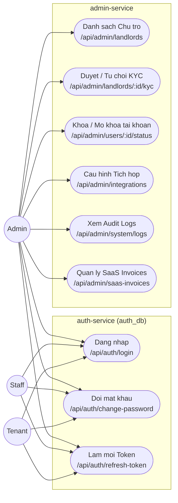

---

### 2.3 Use Case chi tiết — Co so & Phong

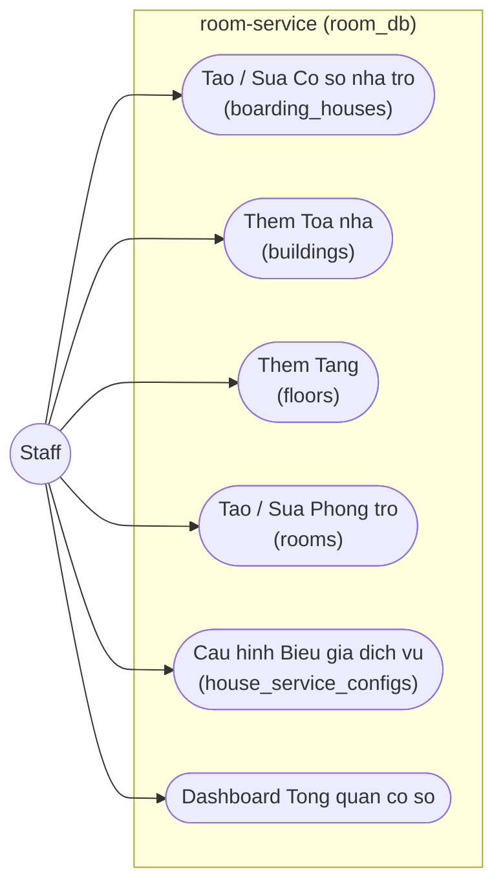

---

### 2.4 Use Case chi tiết — Khach thue & Hop dong

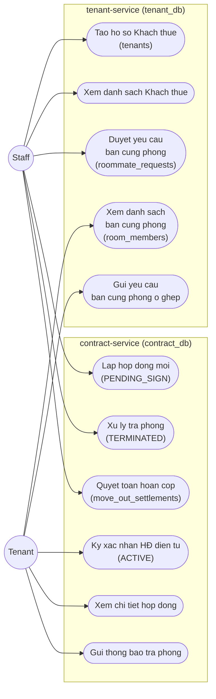

---

### 2.5 Use Case chi tiết — Dien Nuoc & AI OCR

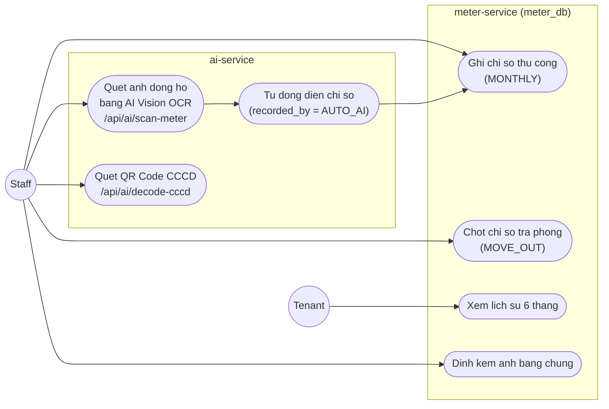

---

### 2.6 Use Case chi tiết — Hoa don & Thanh toan

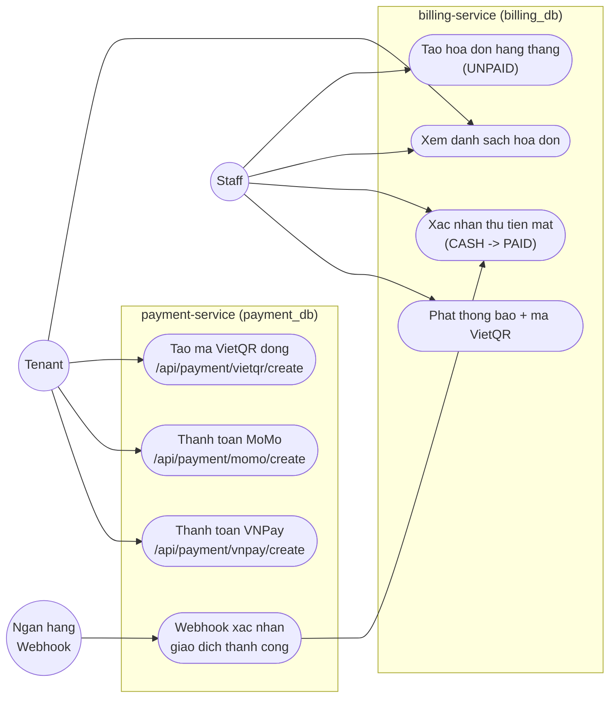

---

### 2.7 Danh mục Use Case đầy đủ

#### ADMIN

| Mã UC | Tên chức năng | Microservice | Route Frontend | Endpoint |
|:------|:-------------|:------------|:--------------|:---------|
| UC-A01 | Quản lý Chủ trọ & Duyệt KYC | `auth-service` | `/admin/landlords` | `GET/PUT /api/admin/landlords` |
| UC-A02 | Cấu hình tích hợp VietQR/MoMo/VNPay/AI/SMS | `payment-service` | `/admin/integrations` | `GET/PUT /api/admin/integrations` |
| UC-A03 | Giám sát Microservices & Audit Logs | `discovery-server` | `/admin/system` | `GET /api/admin/system/logs` |
| UC-A04 | Quản lý SaaS Invoices | `billing-service` | `/admin/saas-invoices` | `GET /api/admin/saas-invoices` |
| UC-A05 | Khóa / Mở khóa tài khoản vi phạm | `auth-service` | `/admin/landlords` | `PUT /api/admin/users/:id/status` |

#### STAFF

| Mã UC | Tên chức năng | Microservice | Page Frontend |
|:------|:-------------|:------------|:-------------|
| UC-S01 | Thiết lập Cơ sở, Tòa nhà, Tầng, Phòng | `room-service` | `BoardingHousesPage`, `RoomsPage` |
| UC-S01B | Cấu hình biểu giá dịch vụ cơ sở | `room-service` | `BoardingHousesPage` |
| UC-S02 | Tiếp nhận khách, Lập hợp đồng & Nhận phòng | `contract-service` + `tenant-service` | `TenantsPage` |
| UC-S02B | Duyệt yêu cầu thêm thành viên ở ghép | `tenant-service` + `auth-service` | `TenantsPage` |
| UC-S03 | Ghi nhận & Chốt chỉ số Điện Nước (AI/Tay) | `meter-service` + `ai-service` | `MetersPage`, `MeterDashboard` |
| UC-S04 | Tính hóa đơn & Thu tiền phòng | `billing-service` + `payment-service` | `InvoicesPage` |
| UC-S05 | Tiếp nhận & Điều phối bảo trì sửa chữa | `maintenance-service` | `MaintenancePage` |
| UC-S06 | Báo cáo Doanh thu, Chi phí & Lấp đầy | `report-service` | `ReportsPage` |
| UC-S07 | Trả phòng, Nghiệm thu & Quyết toán cọc | `contract-service` + `room-service` | `TenantsPage` |

#### TENANT

| Mã UC | Tên chức năng | Microservice | Page Frontend |
|:------|:-------------|:------------|:-------------|
| UC-T01 | Xem hợp đồng & Ký xác nhận điện tử | `contract-service` | `TenantRoomsPage` |
| UC-T02 | Tra cứu điện nước & Đối soát ảnh | `meter-service` | `TenantMetersPage` |
| UC-T03 | Xem hóa đơn & Quét VietQR/MoMo/VNPay | `billing-service` + `payment-service` | `TenantInvoicesPage` |
| UC-T04 | Gửi yêu cầu Báo hỏng kèm ảnh | `maintenance-service` | `TenantMaintenancePage` |
| UC-T05 | Xem danh sách bạn cùng phòng (ẩn CCCD) | `tenant-service` | `TenantDashboard` |
| UC-T06 | Gửi thông báo Trả phòng & Đối soát hoàn cọc | `contract-service` | `TenantRoomsPage` |
| UC-T07 | Đăng ký bạn cùng phòng ở ghép | `tenant-service` | `TenantDashboard` |

---

## 3. ERD — Sơ đồ Thực thể Quan hệ

> **Mô hình:** Database per Service — 8 database MySQL độc lập.
> **Khóa ngoại chéo database:** Logical FK (không ràng buộc DB), đồng bộ qua RabbitMQ Events.

### 3.1 ERD Tổng thể (Cross-database)

```mermaid
erDiagram
    USERS {
        bigint id PK
        varchar username UK
        varchar password
        varchar full_name
        varchar email UK
        varchar phone UK
        varchar role
        varchar status
        datetime created_at
        datetime updated_at
    }
    LANDLORD_PROFILES {
        bigint id PK
        bigint user_id UK_FK
        varchar identity_card UK
        varchar full_name
        date birth_date
        date issue_date
        varchar issue_place
        varchar permanent_address
        varchar cccd_front_url
        varchar cccd_back_url
        varchar tax_code
        varchar business_license_url
        varchar kyc_status
        varchar rejection_reason
        datetime verified_at
        bigint verified_by
        datetime created_at
        datetime updated_at
    }
    BOARDING_HOUSES {
        bigint id PK
        bigint owner_id
        varchar code UK
        varchar name
        varchar address
        varchar ward
        varchar district
        varchar city
        varchar manager_name
        varchar manager_phone
        varchar status
        datetime created_at
    }
    HOUSE_SERVICE_CONFIGS {
        bigint id PK
        bigint boarding_house_id FK
        varchar service_name
        varchar calculation_type
        decimal unit_price
    }
    BUILDINGS {
        bigint id PK
        bigint boarding_house_id FK
        varchar name
        datetime created_at
    }
    FLOORS {
        bigint id PK
        bigint building_id FK
        int floor_number
    }
    ROOMS {
        bigint id PK
        bigint floor_id FK
        varchar room_number
        decimal base_price
        double area
        int max_occupants
        varchar status
        datetime created_at
    }
    AMENITIES {
        bigint id PK
        varchar name
        varchar icon
    }
    ROOM_AMENITIES {
        bigint room_id PK_FK
        bigint amenity_id PK_FK
    }
    TENANTS {
        bigint id PK
        bigint user_id UK
        varchar full_name
        varchar identity_card UK
        date birth_date
        varchar gender
        varchar phone UK
        varchar email
        varchar hometown
        varchar address
        varchar status
    }
    ROOM_MEMBERS {
        bigint id PK
        bigint room_id
        bigint tenant_id FK
        bigint contract_id
        varchar role_in_room
        date join_date
        varchar temp_residence_status
        varchar status
    }
    ROOMMATE_REQUESTS {
        bigint id PK
        bigint room_id
        bigint requested_by_tenant_id FK
        varchar full_name
        varchar identity_card
        varchar phone
        date birth_date
        varchar gender
        varchar hometown
        varchar cccd_front_url
        varchar cccd_back_url
        varchar status
        varchar rejection_reason
        datetime created_at
        datetime reviewed_at
    }
    CONTRACTS {
        bigint id PK
        varchar contract_code UK
        bigint tenant_id
        bigint room_id
        date start_date
        date end_date
        decimal rental_price
        decimal deposit_amount
        int payment_cycle
        varchar status
    }
    MOVE_OUT_SETTLEMENTS {
        bigint id PK
        bigint contract_id FK
        bigint room_id
        date move_out_date
        bigint final_meter_reading_id
        decimal damage_fee
        decimal unpaid_utilities_fee
        decimal original_deposit
        decimal refund_amount
        varchar refund_status
        datetime settled_at
    }
    METER_READINGS {
        bigint id PK
        bigint room_id
        date reading_date
        varchar reading_type
        int recorded_month
        int recorded_year
        double old_electricity
        double new_electricity
        double old_water
        double new_water
        varchar image_evidence_url
        varchar recorded_by
    }
    INVOICES {
        bigint id PK
        varchar invoice_code UK
        bigint contract_id
        bigint room_id
        bigint tenant_id
        int month
        int year
        decimal room_fee
        decimal electricity_fee
        decimal water_fee
        decimal service_fee
        decimal discount
        decimal total_amount
        varchar status
        date due_date
        datetime paid_at
    }
    INVOICE_ITEMS {
        bigint id PK
        bigint invoice_id FK
        varchar item_name
        double quantity
        decimal unit_price
        decimal amount
    }
    PAYMENTS {
        bigint id PK
        bigint invoice_id
        varchar payment_code UK
        decimal amount
        varchar payment_method
        varchar transaction_ref
        varchar status
        datetime payment_time
    }
    MAINTENANCE_REQUESTS {
        bigint id PK
        bigint room_id
        bigint tenant_id
        varchar title
        text description
        varchar image_url
        varchar priority
        varchar status
        decimal cost
        datetime created_at
        datetime resolved_at
    }
    MONTHLY_REPORTS {
        bigint id PK
        bigint boarding_house_id
        int month
        int year
        decimal total_revenue
        decimal total_expense
        decimal net_profit
        double occupancy_rate
        datetime generated_at
    }

    USERS ||--o| LANDLORD_PROFILES : "user_id"
    BOARDING_HOUSES ||--|{ HOUSE_SERVICE_CONFIGS : "boarding_house_id"
    BOARDING_HOUSES ||--|{ BUILDINGS : "boarding_house_id"
    BUILDINGS ||--|{ FLOORS : "building_id"
    FLOORS ||--|{ ROOMS : "floor_id"
    ROOMS ||--|{ ROOM_AMENITIES : "room_id"
    AMENITIES ||--|{ ROOM_AMENITIES : "amenity_id"
    TENANTS ||--|{ ROOM_MEMBERS : "tenant_id"
    TENANTS ||--o{ ROOMMATE_REQUESTS : "requested_by_tenant_id"
    CONTRACTS ||--o| MOVE_OUT_SETTLEMENTS : "contract_id"
    INVOICES ||--|{ INVOICE_ITEMS : "invoice_id"

    USERS ||--o{ BOARDING_HOUSES : "Logic FK: owner_id"
    USERS ||--o| TENANTS : "Logic FK: user_id"
    ROOMS ||--o{ CONTRACTS : "Logic FK: room_id"
    TENANTS ||--o{ CONTRACTS : "Logic FK: tenant_id"
    ROOMS ||--|{ ROOM_MEMBERS : "Logic FK: room_id"
    ROOMS ||--o{ METER_READINGS : "Logic FK: room_id"
    CONTRACTS ||--o{ INVOICES : "Logic FK: contract_id"
    INVOICES ||--o{ PAYMENTS : "Logic FK: invoice_id"
    ROOMS ||--o{ MAINTENANCE_REQUESTS : "Logic FK: room_id"
    TENANTS ||--o{ MAINTENANCE_REQUESTS : "Logic FK: tenant_id"
    BOARDING_HOUSES ||--o{ MONTHLY_REPORTS : "Logic FK: boarding_house_id"
```

---

### 3.2 ERD chi tiết từng Database

#### auth_db

```mermaid
erDiagram
    USERS {
        bigint id PK
        varchar username UK
        varchar password
        varchar full_name
        varchar email UK
        varchar phone UK
        varchar role
        varchar status
        datetime created_at
        datetime updated_at
    }
    LANDLORD_PROFILES {
        bigint id PK
        bigint user_id UK_FK
        varchar identity_card UK
        varchar full_name
        date birth_date
        date issue_date
        varchar issue_place
        varchar permanent_address
        varchar cccd_front_url
        varchar cccd_back_url
        varchar tax_code
        varchar business_license_url
        varchar kyc_status
        varchar rejection_reason
        datetime verified_at
        bigint verified_by
        datetime created_at
        datetime updated_at
    }
    USERS ||--o| LANDLORD_PROFILES : "user_id"
```

#### room_db

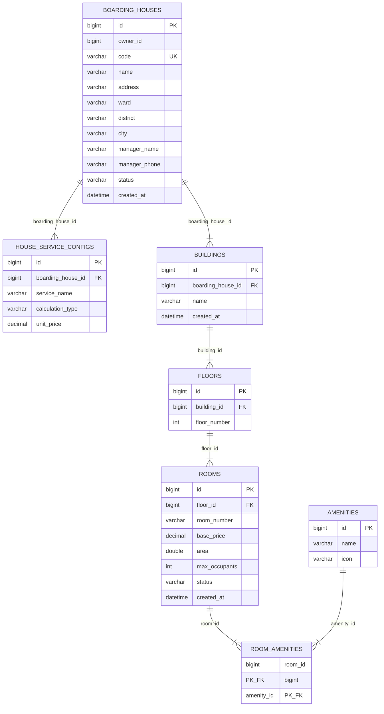

#### tenant_db

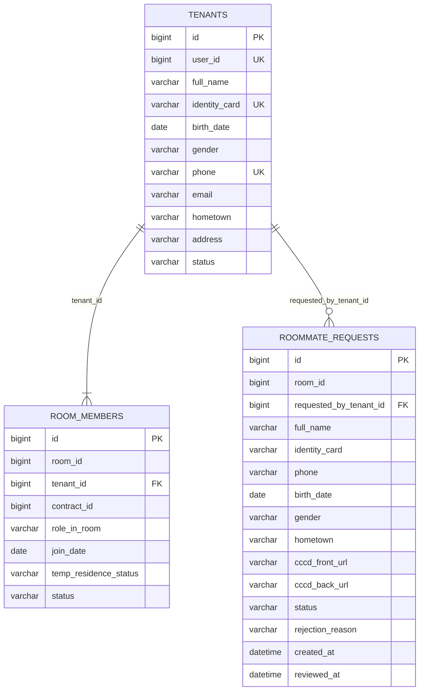

#### contract_db

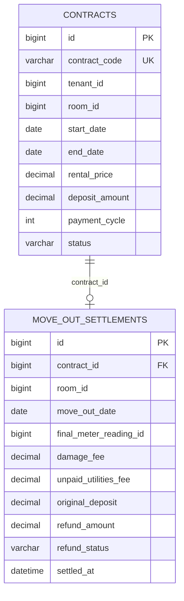

---

## 4. Từ điển Dữ liệu

### 4.1 Enum / Hằng số toàn hệ thống

| Nhóm | Giá trị |
|:-----|:--------|
| **Role** | `ROLE_ADMIN` / `ROLE_STAFF` / `ROLE_TENANT` |
| **User Status** | `ACTIVE` / `LOCKED` |
| **KYC Status** | `PENDING` / `VERIFIED` / `REJECTED` |
| **Room Status** | `AVAILABLE` / `OCCUPIED` / `MAINTENANCE` / `CLEANING` |
| **Contract Status** | `PENDING_SIGN` / `ACTIVE` / `EXPIRED` / `TERMINATED` |
| **Invoice Status** | `UNPAID` / `PAID` / `OVERDUE` / `CANCELLED` |
| **Payment Method** | `VIETQR` / `MOMO` / `VNPAY` / `CASH` / `BANK_TRANSFER` |
| **Payment Status** | `SUCCESS` / `FAILED` |
| **Meter Type** | `MONTHLY` / `MOVE_IN` / `MOVE_OUT` |
| **Service Calc Type** | `METER` / `PER_CAPITA` / `PER_ROOM` |
| **Maintenance Priority** | `LOW` / `MEDIUM` / `HIGH` / `URGENT` |
| **Maintenance Status** | `PENDING` / `IN_PROGRESS` / `RESOLVED` |
| **Room Member Role** | `REPRESENTATIVE` / `MEMBER` |
| **Roommate Request Status** | `PENDING` / `APPROVED` / `REJECTED` |
| **Refund Status** | `COMPLETED` / `PENDING` |
| **Tenant Status** | `ACTIVE` / `INACTIVE` / `BLACKLIST` |
| **Temp Residence Status** | `REGISTERED` / `NOT_REGISTERED` |

### 4.2 Entity — Database Mapping

| Entity | Database | Service |
|:-------|:---------|:--------|
| `users` | `auth_db` | `auth-service` |
| `landlord_profiles` | `auth_db` | `auth-service` |
| `boarding_houses` | `room_db` | `room-service` |
| `house_service_configs` | `room_db` | `room-service` |
| `buildings` | `room_db` | `room-service` |
| `floors` | `room_db` | `room-service` |
| `rooms` | `room_db` | `room-service` |
| `amenities` | `room_db` | `room-service` |
| `room_amenities` | `room_db` | `room-service` |
| `tenants` | `tenant_db` | `tenant-service` |
| `room_members` | `tenant_db` | `tenant-service` |
| `roommate_requests` | `tenant_db` | `tenant-service` |
| `contracts` | `contract_db` | `contract-service` |
| `move_out_settlements` | `contract_db` | `contract-service` |
| `meter_readings` | `meter_db` | `meter-service` |
| `invoices` | `billing_db` | `billing-service` |
| `invoice_items` | `billing_db` | `billing-service` |
| `payments` | `payment_db` | `payment-service` |
| `maintenance_requests` | `maintenance_db` | `maintenance-service` |
| `monthly_reports` | `report_db` | `report-service` |

---

## 5. Kiến trúc Microservices

### 5.1 Sơ đồ tổng thể

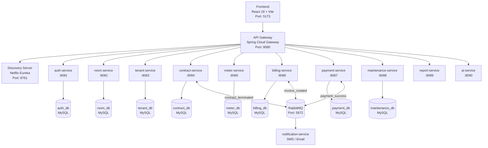

### 5.2 RabbitMQ Events

| Event | Publisher | Consumer |
|:------|:----------|:---------|
| `invoice_created` | `billing-service` | `notification-service` |
| `payment_success` | `payment-service` | `billing-service` |
| `contract_terminated` | `contract-service` | `room-service`, `tenant-service` |
| `tenant_provisioned` | `tenant-service` | `notification-service` |
| `meter_reading_confirmed` | `meter-service` | `billing-service` |

---

## 6. Luồng nghiệp vụ chính

### Luồng 1 — Nhận phòng & Ký hợp đồng

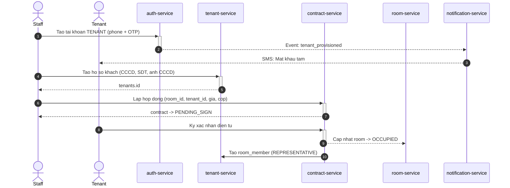

---

### Luồng 2 — Thu tiền hàng tháng

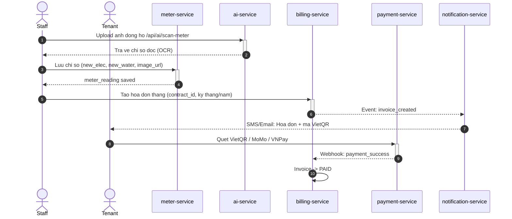

---

### Luồng 3 — Trả phòng & Quyết toán

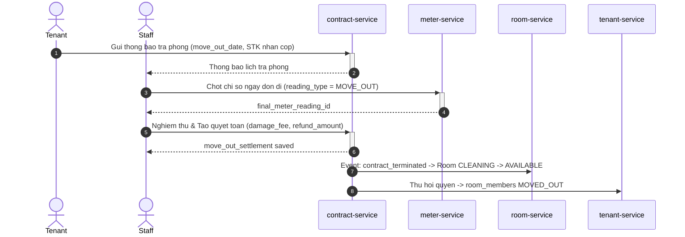

---

### Luồng 4 — Đăng ký bạn cùng phòng

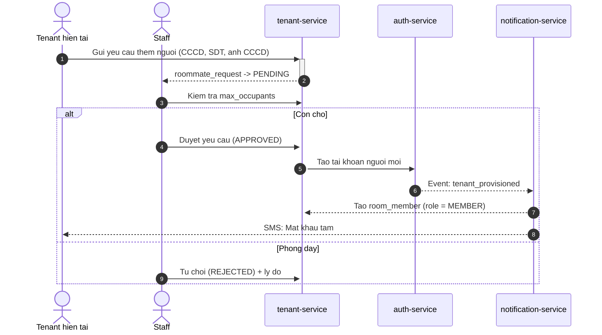

---

## 7. Danh mục API Endpoints

### 7.1 auth-service

| Method | Endpoint | Auth |
|:-------|:---------|:-----|
| `POST` | `/api/auth/login` | Public |
| `POST` | `/api/auth/refresh-token` | Public |
| `PUT` | `/api/auth/change-password` | User |
| `GET` | `/api/admin/users` | ADMIN |
| `PUT` | `/api/admin/users/{id}/status` | ADMIN |
| `GET` | `/api/admin/landlords` | ADMIN |
| `PUT` | `/api/admin/landlords/{id}/kyc` | ADMIN |

### 7.2 room-service

| Method | Endpoint | Auth |
|:-------|:---------|:-----|
| `GET` | `/api/houses` | STAFF |
| `POST` | `/api/houses` | STAFF |
| `PUT` | `/api/houses/{id}` | STAFF |
| `GET` | `/api/houses/{id}/configs` | STAFF |
| `PUT` | `/api/houses/{id}/configs` | STAFF |
| `POST` | `/api/buildings` | STAFF |
| `POST` | `/api/floors` | STAFF |
| `GET` | `/api/rooms` | STAFF |
| `POST` | `/api/rooms` | STAFF |
| `PUT` | `/api/rooms/{id}` | STAFF |
| `PUT` | `/api/rooms/{id}/status` | STAFF |

### 7.3 tenant-service

| Method | Endpoint | Auth |
|:-------|:---------|:-----|
| `GET` | `/api/tenants` | STAFF |
| `POST` | `/api/tenants` | STAFF |
| `GET` | `/api/tenants/{id}` | STAFF/TENANT |
| `GET` | `/api/rooms/{id}/members` | STAFF/TENANT |
| `GET` | `/api/roommate-requests` | STAFF |
| `POST` | `/api/roommate-requests` | TENANT |
| `PUT` | `/api/roommate-requests/{id}` | STAFF |

### 7.4 contract-service

| Method | Endpoint | Auth |
|:-------|:---------|:-----|
| `GET` | `/api/contracts` | STAFF |
| `POST` | `/api/contracts` | STAFF |
| `GET` | `/api/contracts/{id}` | ALL |
| `PUT` | `/api/contracts/{id}/sign` | TENANT |
| `PUT` | `/api/contracts/{id}/terminate` | STAFF |
| `POST` | `/api/contracts/{id}/move-out` | TENANT |
| `POST` | `/api/contracts/{id}/settlement` | STAFF |

### 7.5 meter-service

| Method | Endpoint | Auth |
|:-------|:---------|:-----|
| `GET` | `/api/meters` | STAFF |
| `POST` | `/api/meters` | STAFF |
| `GET` | `/api/meters/room/{id}` | STAFF/TENANT |
| `POST` | `/api/ai/scan-meter` | STAFF |

### 7.6 billing-service

| Method | Endpoint | Auth |
|:-------|:---------|:-----|
| `GET` | `/api/invoices` | STAFF |
| `POST` | `/api/invoices` | STAFF |
| `GET` | `/api/invoices/{id}` | ALL |
| `PUT` | `/api/invoices/{id}/confirm-cash` | STAFF |
| `GET` | `/api/invoices/tenant` | TENANT |

### 7.7 payment-service

| Method | Endpoint | Auth |
|:-------|:---------|:-----|
| `POST` | `/api/payment/vietqr/create` | TENANT |
| `POST` | `/api/payment/momo/create` | TENANT |
| `POST` | `/api/payment/vnpay/create` | TENANT |
| `GET` | `/api/payment/vnpay-return` | Public |
| `POST` | `/api/payment/momo-return` | Public |
| `GET` | `/api/payments` | STAFF |

### 7.8 maintenance-service

| Method | Endpoint | Auth |
|:-------|:---------|:-----|
| `GET` | `/api/maintenance` | STAFF |
| `POST` | `/api/maintenance` | TENANT |
| `PUT` | `/api/maintenance/{id}/assign` | STAFF |
| `PUT` | `/api/maintenance/{id}/resolve` | STAFF |
| `GET` | `/api/maintenance/room/{id}` | ALL |

### 7.9 report-service

| Method | Endpoint | Auth |
|:-------|:---------|:-----|
| `GET` | `/api/reports/monthly` | STAFF |
| `GET` | `/api/reports/occupancy` | STAFF |
| `GET` | `/api/reports/debt` | STAFF |
| `GET` | `/api/reports/maintenance-cost` | STAFF |

---

## 8. Phân quyền & Bảo mật

### 8.1 Ma trận phân quyền

| Chức năng | ADMIN | STAFF | TENANT |
|:----------|:-----:|:-----:|:------:|
| Quản lý tài khoản toàn hệ thống | Y | N | N |
| Duyệt KYC chủ trọ | Y | N | N |
| Khóa/mở khóa tài khoản | Y | N | N |
| Cấu hình tích hợp (VietQR/AI...) | Y | N | N |
| Xem audit logs | Y | N | N |
| Tạo/sửa cơ sở, tòa, tầng, phòng | N | Y | N |
| Lập/kết thúc hợp đồng | N | Y | N |
| Ghi chỉ số điện nước | N | Y | N |
| Tạo hóa đơn & thu tiền | N | Y | N |
| Xem báo cáo tài chính | N | Y | N |
| Xem hợp đồng của mình | N | N | Y |
| Xem hóa đơn & thanh toán | N | N | Y |
| Báo hỏng thiết bị | N | N | Y |
| Đăng ký bạn cùng phòng | N | N | Y |

### 8.2 Nguyên tắc Cô lập dữ liệu

> [!IMPORTANT]
> Strict Multi-tenant Isolation: Dữ liệu Chủ trọ A tuyệt đối không xem được bởi Chủ trọ B. Mọi query phải có `WHERE owner_id = :current_user_id`.

| Nguyên tắc | Mô tả kỹ thuật |
|:-----------|:--------------|
| **Single Active Lease** | Mỗi khách chỉ có 1 `contract` với `status = ACTIVE` tại 1 thời điểm |
| **Data Isolation** | `WHERE owner_id = :staffId` trong mọi query phòng/cơ sở |
| **Account Lifecycle** | Tài khoản KHÔNG bị xóa/khóa khi trả phòng — vẫn `ACTIVE` |
| **Non-repudiation** | Staff KHÔNG được xem/đổi mật khẩu của khách |
| **Locked only on** | Brute-force >= 5 lần sai hoặc Admin thủ công khóa |

---

## 9. Cấu trúc Frontend

### 9.1 Cấu trúc thư mục

```
frontend/src/
├── pages/
│   ├── auth/
│   │   └── LoginPage.jsx
│   ├── admin/
│   │   ├── AdminDashboard.jsx
│   │   ├── AdminLandlordsPage.jsx
│   │   ├── AdminHousesPage.jsx
│   │   ├── AdminSaasInvoicesPage.jsx
│   │   ├── AdminIntegrationsPage.jsx
│   │   └── AdminSystemPage.jsx
│   ├── user/
│   │   ├── UserDashboard.jsx
│   │   ├── BoardingHousesPage.jsx
│   │   ├── RoomsPage.jsx
│   │   ├── TenantsPage.jsx
│   │   ├── MetersPage.jsx
│   │   ├── MeterDashboard.jsx
│   │   ├── InvoicesPage.jsx
│   │   ├── MaintenancePage.jsx
│   │   └── ReportsPage.jsx
│   ├── tenants/
│   │   ├── TenantDashboard.jsx
│   │   ├── TenantRoomsPage.jsx
│   │   ├── TenantMetersPage.jsx
│   │   ├── TenantInvoicesPage.jsx
│   │   └── TenantMaintenancePage.jsx
│   └── payment/
│       ├── VNPayReturnPage.jsx
│       └── MoMoReturnPage.jsx
├── contexts/
│   ├── AuthContext.jsx
│   └── DataContext.jsx
├── services/
│   ├── api.js
│   ├── aiService.js
│   ├── vnpayService.js
│   ├── momoService.js
│   └── sepayService.js
└── components/
    └── layout/
        └── AppLayout.jsx
```

### 9.2 Route Map

| URL Path | Component | Role |
|:---------|:----------|:-----|
| `/login` | `LoginPage` | Public |
| `/` | `Dashboard` | ALL |
| `/houses` | `BoardingHousesPage` | STAFF |
| `/rooms` | `RoomsPage` | STAFF |
| `/tenants` | `TenantsPage` | STAFF |
| `/meters` | `MetersPage` | STAFF |
| `/meters/dashboard` | `MeterDashboard` | STAFF |
| `/invoices` | `InvoicesPage` | STAFF |
| `/maintenance` | `MaintenancePage` | STAFF |
| `/reports` | `ReportsPage` | STAFF |
| `/tenants/dashboard` | `TenantDashboard` | TENANT |
| `/tenants/rooms` | `TenantRoomsPage` | TENANT |
| `/tenants/meters` | `TenantMetersPage` | TENANT |
| `/tenants/invoices` | `TenantInvoicesPage` | TENANT |
| `/tenants/maintenance` | `TenantMaintenancePage` | TENANT |
| `/admin/dashboard` | `AdminDashboard` | ADMIN |
| `/admin/landlords` | `AdminLandlordsPage` | ADMIN |
| `/admin/houses` | `AdminHousesPage` | ADMIN |
| `/admin/saas-invoices` | `AdminSaasInvoicesPage` | ADMIN |
| `/admin/integrations` | `AdminIntegrationsPage` | ADMIN |
| `/admin/system` | `AdminSystemPage` | ADMIN |
| `/payment/vnpay-return` | `VNPayReturnPage` | Public |
| `/payment/momo-return` | `MoMoReturnPage` | Public |

---

## 10. Ràng buộc nghiệp vụ quan trọng

> [!WARNING]
> Các ràng buộc sau phải được tuân thủ nghiêm ngặt trong mọi implementation.

### 10.1 Ràng buộc về Tài khoản

| # | Ràng buộc | Chi tiết |
|:--|:----------|:---------|
| R1 | Single Active Lease | Mỗi khách chỉ có 1 `contract` với `status = ACTIVE` tại 1 thời điểm |
| R2 | Không xóa tài khoản | Chỉ thu hồi quyền liên kết phòng, không xóa/khóa account |
| R3 | Không khóa khi trả phòng | Tài khoản vẫn `ACTIVE` để xem lịch sử hóa đơn, hợp đồng |
| R4 | Mật khẩu bảo mật | Staff không được xem/đặt mật khẩu thô của khách |
| R5 | Brute-force protection | Tự động khóa sau 5 lần nhập sai liên tiếp |

### 10.2 Ràng buộc về Dữ liệu

| # | Ràng buộc | Chi tiết |
|:--|:----------|:---------|
| R6 | Data Isolation | `WHERE owner_id = ?` bắt buộc trong mọi query liên quan cơ sở/phòng |
| R7 | CCCD Masking | Số CCCD bạn cùng phòng phải được che một phần khi hiển thị |
| R8 | Logical FK | Khóa ngoại cross-database là số nguyên thuần, không CONSTRAINT DB |
| R9 | max_occupants | Kiểm tra số người hiện tại < max trước khi duyệt roommate_request |
| R10 | Audit trail | Ảnh chụp đồng hồ lưu kèm timestamp để đối soát tranh chấp |

### 10.3 Ràng buộc về Tài chính

| # | Ràng buộc | Chi tiết |
|:--|:----------|:---------|
| R11 | Công thức quyết toán | `refund_amount = deposit - damage_fee - unpaid_utilities_fee` |
| R12 | VietQR auto-reconcile | Webhook thanh cong -> Invoice `PAID` trong 5-10 giay |
| R13 | Invoice immutable | Hoa don `PAID` khong duoc sua, chi tao hoa don dieu chinh moi |
| R14 | Meter reading | Bat buoc co `MOVE_IN` reading khi nhan phong de tinh chinh xac lan dau |

---

*Backend: Spring Boot 3 Microservices | Frontend: React 18 + Vite*
