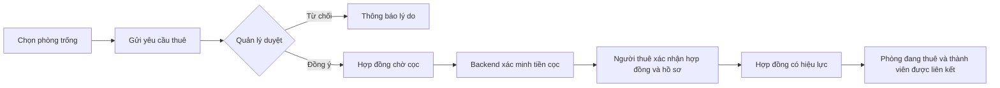
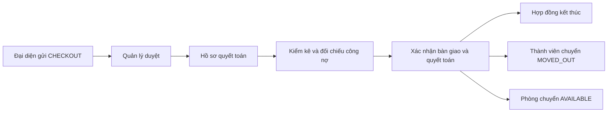

# Phân tích luồng nghiệp vụ giao diện tenant

Ngày kiểm tra: 15/11/2026. Phạm vi: 5 màn hình tenant, các modal, DataContext, API và controller/service liên quan.

## Phạm vi kiểm chứng

- Đã mở cả 5 màn hình trên trình duyệt với dữ liệu API local: cổng khách, phòng, điện nước, hóa đơn, bảo trì.
- Đã rà mã nguồn cho toàn bộ các luồng trong bảng dưới. Không đồng nghĩa mọi nhánh đã được kiểm thử xuyên suốt với tài khoản tenant thật.
- Frontend đang bật `VITE_TEST_MODE=true`; Gateway có chế độ test gán đồng thời quyền Admin/Staff/Tenant. Do đó chuyển sang giao diện Tenant chưa chứng minh phân quyền Tenant thật hoạt động đúng.
- Khi kiểm tra lỗi ghi nhận thanh toán và khiếu nại, các yêu cầu ghi bị chặn ở trình duyệt, trả lỗi 503 giả lập. Không thanh toán, gửi khiếu nại hoặc thay đổi dữ liệu nghiệp vụ thật trong đợt rà soát này.
- Chạy lại: 8 kiểm thử API đạt; 3 kiểm thử trình duyệt hồi quy đặt cọc/quyết toán đạt. Bài test tạo đơn thật qua Gateway được bỏ qua trong lần này.
- File kết quả kiểm tra trình duyệt tạm đã được xóa theo yêu cầu dọn file kiểm thử.

Quy ước: **Đạt bước đã thử** = chỉ xác nhận phạm vi đã thử; **Lỗi** = phát hiện sai hành vi/dữ liệu; **Thiếu** = có một phần nhưng chưa khép kín; **Chưa có UI** = chưa tìm thấy thao tác tenant gọi luồng đó.

## Bảng phân tích các luồng

| Mã | Chức năng / điều kiện | Luồng nghiệp vụ cần có | API / dữ liệu liên quan | Hiện trạng và kết luận |
|---|---|---|---|---|
| T01 | Đăng ký tenant mới | Nhập thông tin → xác thực → tạo tài khoản và liên kết hồ sơ khách thuê → đăng nhập → được phép gửi đơn thuê | `POST /auth/register`, `/auth/login`; users, tenants | **Thiếu.** AuthService lưu user nhưng chưa thấy bước tạo/liên kết hồ sơ tenant. Khi tắt test mode, người mới có thể không tìm được tenantId để đặt phòng. Chưa tạo tài khoản thật trong đợt kiểm tra. |
| T02 | Đăng nhập, khôi phục phiên, đăng xuất | Đăng nhập → token → xác định đúng vai trò → khôi phục phiên; hết hạn thì refresh hoặc đăng xuất | `/auth/login`, `/auth/me`, `/auth/refresh`; AuthContext, api.js | API có luồng xử lý phiên; các unit test liên quan đạt. **Chưa chứng minh quyền tenant thực** do đang bật test mode. Đăng xuất trong test mode trở lại tài khoản thử. |
| T03 | Cổng khách, phòng đang thuê, người đại diện | Xác định hồ sơ khách → hợp đồng/thành viên đang hiệu lực → phòng đúng cơ sở → quyền tương ứng | `/tenants`, `/contracts`, `/tenants/members`, `/rooms` | **Tải được.** Dashboard đã dùng ID hợp đồng/phòng ở luồng chính. Vẫn còn fallback thông tin cá nhân và một số chỗ dò tên; số người trong phòng đang đếm số hợp đồng thay vì số cư dân. |
| T04 | Tìm phòng, lọc cơ sở/khu vực/giá, xem chi tiết | Đọc danh sách phòng → lọc → xem giá/diện tích/trạng thái → chỉ đăng ký phòng phù hợp | `GET /properties`, `/rooms` | **Tải được.** Có tìm kiếm/lọc và nút đặt cho AVAILABLE. Ảnh có thể là ảnh thay thế; một số địa chỉ/khu vực có fallback. Trùng số phòng giữa các cơ sở cần luôn dùng roomId. |
| T05 | Gửi yêu cầu đặt cọc/thuê phòng | Chọn phòng → xem điều khoản → xác nhận → lưu đơn PENDING → hiển thị đúng kết quả API | `POST /contracts/requests`, type `RENT` | **Đạt bước đã thử.** Đã dùng roomId thật; chờ API trước khi báo thành công và cho thử lại khi API lỗi. Chưa phải bằng chứng đã thu 1 triệu hoặc đã ký hợp đồng thật; CCCD nhập trong modal chưa được callback này lưu vào hồ sơ. |
| T06 | Quản lý duyệt thuê | Kiểm tra phòng và người thuê → duyệt → tạo hợp đồng ở trạng thái chờ cọc/ký → kích hoạt sau khi đủ điều kiện | `/contracts/requests/{id}/approve`; ContractServiceImpl | **Sai thứ tự.** Duyệt RENT hiện tạo hợp đồng ACTIVE và chuyển phòng OCCUPIED ngay; depositPaid/signedElectronically có thể vẫn false. Tiền cọc được lấy bằng giá thuê phòng, không phải mức 1 triệu ghi trên nút đặt cọc. |
| T07 | Nộp cọc và xác nhận giao dịch | Hợp đồng chờ cọc → QR/nội dung/số tiền đúng → backend xác minh tiền → lưu giao dịch → cập nhật đã nhận cọc | `/payments/sepay/check`; `/contracts/{id}/confirm-deposit` | **Chưa khép kín.** Frontend kiểm tra cọc truyền nội dung/số tiền, trong khi service check nhận invoiceId. Tenant còn gọi API confirm-deposit vốn chỉ cho quản lý. Enum hợp đồng chưa có PENDING_DEPOSIT/PENDING_SIGN mà UI đang chờ. Không thử chuyển tiền thật. |
| T08 | Ký hợp đồng, CCCD, đồng ý tạm trú | Có hợp đồng hợp lệ → hồ sơ định danh → xác minh người ký → lưu chữ ký/hồ sơ → cập nhật trạng thái → chuẩn bị đăng ký tạm trú | `/contracts/{id}/sign`; ResidentContractModal | **Thiếu.** `/sign` chỉ cập nhật cờ và thời điểm ký, chưa thấy xác minh OTP/chữ ký hoặc quyền sở hữu tại endpoint. Form dùng thông tin/ảnh mẫu. Nhánh onboarding đang gọi confirm-deposit với cccdData nhưng backend không lưu hồ sơ này. |
| T09 | Xem, in/tải hợp đồng | Đọc bản hợp đồng thật → hiển thị số tiền/điều khoản/người ký → in hoặc lưu PDF | `GET /contracts`; cửa sổ HTML/print | Có chức năng tạo bản in bằng trình duyệt. **Cần sửa nội dung:** nhiều trường thiếu được thay bằng tên, mã, ngày hoặc tiền mẫu; không có bằng chứng tài liệu PDF đã được backend lưu và quản lý phiên bản. |
| T10 | Giữ chỗ 15 phút, hủy giữ chỗ | Server khóa phòng với hạn giữ → hết hạn/hủy thì giải phóng đúng phòng của tenant → không hủy đơn người khác | `DELETE /contracts/requests/{id}` | **Thiếu/lỗi quyền.** Đồng hồ đếm ở frontend; chưa có trạng thái HOLDING trong enum phòng hoặc cơ chế hết hạn backend tương ứng. Hủy tìm đơn theo số phòng/PENDING; API xóa chỉ cho quản lý. Nhánh onboarding còn có thể không xuất hiện vì trạng thái hợp đồng không khớp. |
| T11 | “Đơn của tôi”, theo dõi duyệt/từ chối | Chỉ lấy đơn của đúng tenant → phân loại loại đơn → hiển thị đầy đủ trạng thái → cập nhật sau xử lý | `GET /contracts/requests` | **Lỗi phạm vi và nhãn.** Modal hiện map toàn bộ roomRequests; API trả findAll. REJECTED/WAITING_ROOMMATES bị hiển thị chung “Chờ duyệt”; CHECKOUT có thể bị ghi nhãn “Ở ghép”. |
| T12 | Đăng ký người ở ghép | Có hợp đồng và quyền bảo trợ → nhập hồ sơ → kiểm tra sức chứa/CCCD → gửi PENDING → quản lý duyệt → tạo/liên kết tenant và thành viên ACTIVE | `/tenants/roommate-requests`, `/{id}/review` | Có API gửi/duyệt. **Thiếu kiểm tra:** backend chưa thấy kiểm tra sức chứa và hợp đồng bảo trợ khớp phòng. CCCD đã tồn tại có thể bị từ chối thay vì tái sử dụng tenant. DataContext bỏ cccdFrontUrl/cccdBackUrl dù form có chúng. |
| T13 | Biểu quyết của bạn cùng phòng | Xác định thành viên có quyền → lưu một phiếu/người → tổng hợp đồng ý/từ chối → chuyển trạng thái đơn | `/contracts/requests/{id}/vote`, room_request_votes | **Chưa hoàn chỉnh.** Backend chỉ lưu phiếu; chưa tổng hợp để chuyển WAITING_ROOMMATES sang PENDING hoặc REJECTED. API danh sách chưa trả roommateVotes cho UI kiểm tra đã bỏ phiếu. Số người và luồng checkout cũng chưa tạo đúng trạng thái chờ biểu quyết. |
| T14 | Xem chỉ số và lịch sử điện nước | Xác định roomId và tháng → đọc công tơ thật → tính tiêu thụ/đơn giá → hiển thị trạng thái hóa đơn thực | `/meters/rooms/{roomId}`, `/rooms/service-configs`, invoices | **Sai dữ liệu.** UI tìm readings theo `room` nhưng DataContext giữ `roomId`; thiếu dữ liệu thì dùng 1450→1525 và 85→92. Lịch sử cũ được tự sinh bằng công thức, gán paid=true, năm cố định 2026. |
| T15 | Gửi khiếu nại điện nước | Chọn đúng tháng/phòng/công tơ → nhập chỉ số/ảnh/lý do → kiểm tra → chờ API → chỉ báo đã gửi khi lưu thành công | `POST /meters/disputes` | **Lỗi đã tái hiện trên trình duyệt:** API 503 nhưng modal vẫn báo gửi thành công. Callback không được await. Tháng đang xem chưa được truyền vào recordedPeriod nên có thể ghi nhầm kỳ hiện tại. |
| T16 | Theo dõi và xử lý khiếu nại | Tenant xem tiến độ → quản lý đối soát → điều chỉnh reading/hóa đơn nếu cần → lưu kết quả → thông báo tenant | `PATCH /meters/disputes/{id}` | **Thiếu.** API hiện đổi trạng thái/ghi chú; chưa thấy nối sang điều chỉnh reading và hóa đơn. Chưa có bảng theo dõi khiếu nại của tenant trên màn hình điện nước. |
| T17 | Xem/lọc/tìm và xem chi tiết hóa đơn | Chỉ lấy hóa đơn đúng khách/phòng → lọc kỳ/trạng thái → hiển thị đủ tiền phòng/điện/nước/dịch vụ | `GET /invoices`; allInvoices | **Tải được nhưng có lỗi.** allInvoices là dữ liệu chưa enrich; nhiều chỗ đợi code/room/electricFee thay vì invoiceCode/roomId/electricityFee. Hàm lọc thực tế ném lỗi `inv.month.toLowerCase is not a function` với month dạng số; đã chạy riêng selector để xác nhận. |
| T18 | Thanh toán hóa đơn, SePay/VNPay/MoMo, callback | Chọn hóa đơn → tạo giao dịch → xác minh backend → ghi payment → cập nhật PAID → refresh; thất bại phải giữ công nợ | `/invoices/{id}/confirm-payment`, `/payments`, `/payments/sepay/check`, `/payments/vnpay/*`, `/payments/momo/*` | **Lỗi nghiêm trọng đã tái hiện:** cả hai API ghi trả 503 nhưng UI vẫn báo thành công vì payInvoice nuốt lỗi. Nút thanh toán nhanh đang gọi CASH. API confirm-payment hiện không kiểm tra quyền quản lý, chủ hóa đơn hoặc giao dịch xác minh tại controller. Các service cổng thanh toán có tồn tại nhưng chưa kiểm thử giao dịch ngoài hệ thống. |
| T19 | Tạo báo hỏng/sửa chữa | Có phòng đang thuê → chọn đúng phòng/loại/mức độ → mô tả/ảnh → lưu → quản lý tiếp nhận | `POST /maintenance` | Có đường API tạo ticket. **Chưa chuẩn:** chọn “Khu vực chung” có thể không resolve được roomId; category không có trong DTO/backend mapping; form dùng URL/ảnh mẫu, chưa có luồng tải ảnh thực lên kho lưu trữ. |
| T20 | Theo dõi báo hỏng, xem ảnh và người xử lý | Chỉ đọc ticket đúng tenant/phòng/cơ sở → xem tiến độ/người xử lý → xem kết quả sửa | `GET /maintenance`, cập nhật từ quản lý | **Tải được nhưng cần đối soát.** Lọc theo số phòng hoặc tên dễ lẫn cơ sở. UI và backend có nhiều bộ tên trạng thái; thông tin kỹ thuật viên cần lấy từ dữ liệu thật, không suy từ fallback. |
| T21 | Rời phòng cá nhân, bàn giao đại diện | Kiểm tra thành viên/công nợ → thành viên rút tên; đại diện còn người ở phải chọn người tiếp quản → giữ hợp đồng cho người còn lại | `POST /contracts/{id}/leave` | Nhánh cơ bản đã có kiểm thử backend ở lần sửa trước. **Còn thiếu:** lý do chưa được lưu; người ở ghép không có email liên kết có thể vướng xác minh; người cuối cùng rời đang kết thúc hợp đồng trực tiếp mà không tạo hồ sơ quyết toán. Chưa thử rời phòng thật trong lần audit này. |
| T22 | Trả toàn bộ phòng từ dashboard | Người đại diện, đúng hợp đồng, đủ điều kiện → gửi CHECKOUT → quản lý duyệt → tạo hồ sơ quyết toán → bàn giao → kết thúc hợp đồng | `/contracts/requests`, `/{id}/approve`, `/contracts/settlements/{id}/complete` | **Đạt phần hồi quy đã thử.** Đã tạo hồ sơ sau duyệt, hỗ trợ đơn cũ thiếu hồ sơ, kết thúc hợp đồng/giải phóng phòng ở bước cuối. Điều kiện công nợ chủ yếu nằm ở UI; kiểm tra quyền sở hữu và biểu quyết nhiều người cần bổ sung backend. |
| T23 | “Báo trả phòng” từ danh sách phòng | Tenant chọn hợp đồng/phòng của mình → khai ngày/lý do/tài khoản → dùng chung quy trình xét duyệt trả phòng | `POST /contracts/settlements` | **Luồng khác T22.** Đi thẳng tạo settlement; còn fallback hợp đồng/phòng mẫu và tìm bằng số phòng, có thể nhầm cơ sở. Cần thống nhất một quy trình và cùng quy tắc người đại diện, công nợ, biểu quyết. |
| T24 | Quyết toán và hoàn cọc | Quản lý kiểm kê → đối chiếu tiền nợ/phí/cọc → xác nhận hoàn/thu bù → chốt → contract TERMINATED, members MOVED_OUT, room AVAILABLE | `/contracts/settlements/{id}/complete` | **Đạt phần hồi quy đã thử:** sửa form tiền điện nước, phục hồi hồ sơ và hoàn tất. **Còn thiếu đối soát tài chính:** FE tính unpaidRentFee nhưng DataContext/backend chưa đưa khoản này vào phép trừ cuối; form có chỉ số/đơn giá/ngân hàng fallback; backend luôn đặt refundStatus=COMPLETED, chưa phản ánh lựa chọn “chờ chuyển khoản”. |
| T25 | Thông báo và đánh dấu đã đọc | Đọc thông báo theo user đang đăng nhập → mở đúng nghiệp vụ → đánh dấu một/tất cả → cập nhật số chưa đọc | `/notifications`, `/unread-count`, `/{id}/read`, `/read-all` | Có API lọc theo user và đánh dấu đọc. **Cần kiểm thử tài khoản thật:** Gateway test cố định userId=2, nên đổi giao diện sang tenant không đổi chủ thông báo backend. Link nhiều loại đang trỏ chung về dashboard. |
| T26 | Gia hạn / chuyển phòng | Tenant chọn hợp đồng và thời hạn/phòng mới → gửi đơn → kiểm tra điều kiện → quản lý duyệt → cập nhật hợp đồng/phòng | `RENEW_CONTRACT`, `TRANSFER` trong `/contracts/requests`; DataContext có action | **Chưa có UI tenant gọi các action tương ứng** trong các trang/modal đã rà. Backend có nhánh xử lý; chuyển phòng còn kết thúc hợp đồng cũ trước khi tạo hợp đồng mới, cần xử lý thất bại giữa các service. Không coi đây là chức năng tenant đã hoàn chỉnh. |

## Các lỗi ưu tiên và bằng chứng

| Ưu tiên | Phát hiện | Bằng chứng / tái hiện | Hướng xử lý |
|---|---|---|---|
| P0 | Gạch nợ không có bước xác minh tiền/quyền tại endpoint confirm-payment | `InvoiceWorkflowController.confirmPayment` trực tiếp đặt PAID, không nhận header quyền/người dùng; qua rà mã | Chỉ cho quản lý xác nhận thủ công hoặc payment-service ghi giao dịch đã xác minh; kiểm tra chủ hóa đơn, số tiền, trạng thái và chống ghi lặp. |
| P0 | API thanh toán lỗi nhưng UI báo thành công | Trình duyệt: chặn POST confirm-payment và POST payments bằng 503; UI hiện “Thanh toán hóa đơn thành công!” | Bỏ catch rỗng, không gán PAID khi backend chưa xác nhận; callback phải trả thất bại khi ghi nhận thất bại. |
| P1 | Duyệt thuê kích hoạt trước cọc/ký, mức cọc UI/backend khác nhau | UI đề nghị 1 triệu; approve lấy room.basePrice và createContract đặt ACTIVE | Thống nhất tiền giữ chỗ/tiền cọc và vòng đời hợp đồng; chỉ kích hoạt khi đủ điều kiện thực tế. |
| P1 | Hồ sơ mới chưa được liên kết sau đăng ký tài khoản | AuthService.register chỉ tạo user; gửi đơn cần tenantId | Tạo/liên kết hồ sơ tenant bằng userId, không fallback sang người đầu tiên. |
| P1 | Lẫn dữ liệu giữa tenant/cơ sở | Dò tên/số phòng ở invoices/meters/maintenance; “Đơn của tôi” map toàn bộ dữ liệu; nhiều list API dùng findAll | Lọc phía server bằng user→tenantId và roomId; frontend chỉ hiển thị dữ liệu đã được phép. |
| P1 | Điện nước hiển thị dữ liệu sinh tự động | `UserMetersPage` có công thức tạo lịch sử và gán paid=true; raw readings được tìm sai trường | Dùng dữ liệu đo thật theo roomId/kỳ; thiếu dữ liệu thì để trống và ghi rõ chưa chốt. |
| P1 | Khiếu nại gửi thất bại vẫn báo đã gửi | Trình duyệt: POST meters/disputes trả 503 nhưng modal hiện thành công | Await callback, khóa gửi lặp, hiển thị lỗi và chỉ cập nhật thành công sau khi có bản ghi. |
| P1 | Biểu quyết không chuyển tiếp workflow | `vote()` chỉ lưu phiếu; `listRoomRequests()` không enrich phiếu cho UI | Kiểm tra thành viên hợp lệ, đủ phiếu, tổng hợp kết quả và chuyển trạng thái tự động. |
| P1 | Quyết toán FE/backend không cùng phép tính và trạng thái hoàn tiền | unpaidRentFee/refundStatus UI không được đưa đầy đủ vào complete payload/logic | Backend tính số tiền cuối từ sổ công nợ; phân biệt bàn giao xong với đã hoàn tiền thật. |
| P2 | Tìm hóa đơn theo kỳ gây lỗi với month dạng số | Chạy chính phần thân selector từ file UI với `month: 9`, tìm chuỗi không khớp → TypeError | Chuẩn hóa kỳ thành chuỗi tháng/năm, dùng cùng DTO đã enrich. |
| P2 | Hồ sơ giấy tờ/ảnh còn dữ liệu mẫu hoặc chưa được lưu | ResidentContractModal, RoommateRequestModal, DataContext | Bỏ mặc định giả, lưu hồ sơ/ảnh theo API thật, hiển thị trạng thái chưa có thay vì thay thế bằng thông tin mẫu. |

P0 = ưu tiên xử lý trước khi dùng thanh toán thực; P1 = làm sai hoặc làm tắc luồng nghiệp vụ; P2 = lỗi thao tác/hiển thị cần sửa. Đây là đánh giá kỹ thuật theo hành vi đã quan sát và mã nguồn, không phải kết luận kiểm định an toàn toàn hệ thống.

## Sơ đồ luồng thuê phòng cần đạt

Đây là luồng đề xuất để thống nhất nghiệp vụ. Hiện tại code đi từ duyệt RENT sang ACTIVE trực tiếp, nên chưa thực hiện đủ các bước giữa.

## Sơ đồ trả toàn bộ phòng sau phần sửa đã có

Biểu quyết nhiều người, công nợ, quyền sở hữu và xác nhận hoàn tiền cần được thực thi thống nhất phía backend; sơ đồ trên không có nghĩa các điều kiện này đã được kiểm chứng đầy đủ.

## Thứ tự hoàn thiện

1. Sửa ghi nhận thanh toán và kiểm soát quyền; loại bỏ báo thành công khi API lỗi.
2. Thống nhất vòng đời thuê → cọc → ký → có hiệu lực, và liên kết user với tenant.
3. Chuẩn hóa dữ liệu tenant/roomId và bỏ toàn bộ số điện nước/hồ sơ giả.
4. Khép kín ở ghép, sức chứa, biểu quyết, khiếu nại và hai đường trả phòng.
5. Kiểm thử lại bằng tài khoản tenant thật: người mới, đại diện, thành viên ở ghép, nhiều phòng/khác cơ sở, còn nợ và hết hạn hợp đồng.

## Nguồn mã chính đã kiểm tra

- `frontend/src/pages/user/`: UserDashboard, UserRoomsPage, UserMetersPage, UserInvoicesPage, UserMaintenancePage.
- `frontend/src/components/tenant/`: ResidentContractModal, RoommateRequestModal, MeterDisputeModal.
- `frontend/src/components/settlement/`: TenantMoveOutNoticeModal, MoveOutSettlementModal.
- `frontend/src/contexts/`: AuthContext, DataContext; `frontend/src/services/`: api, sepayService, vnpayService, momoService.
- ContractWorkflowController, PersonalLeaveController, ContractServiceImpl, RoommateWorkflowController, MeterDisputeController, InvoiceWorkflowController, PaymentController, SePayController, NotificationController và các DTO liên quan.

Đợt này tạo báo cáo/kiểm thử kiểm tra; không sửa các lỗi nghiệp vụ mới phát hiện trong mã ứng dụng.
