# SƠ ĐỒ USE CASE
## Hệ Thống Quản Lý Chuỗi Phòng Trọ Đa Chi Nhánh (Microservices SaaS)

> Phân tích từ source code thực tế — Backend (Spring Boot Microservices) + Frontend (React/Vite)

---

## 1. Sơ đồ Use Case Tổng thể

```mermaid
flowchart LR
    %% ===== ACTORS =====
    ADMIN(("Admin\nNền tảng"))
    STAFF(("Staff\nChủ trọ / Quản lý"))
    TENANT(("Tenant\nKhách thuê"))

    %% ===== ADMIN MODULE =====
    subgraph ADM["Phân hệ Quản trị Nền tảng (admin-service)"]
        direction TB
        A01(["UC-A01\nQuản lý Chủ trọ & KYC"])
        A02(["UC-A02\nCấu hình tích hợp\nVietQR / MoMo / VNPay / AI / SMS"])
        A03(["UC-A03\nGiám sát Microservices\n& Audit Logs"])
        A04(["UC-A04\nQuản lý SaaS Invoices"])
        A05(["UC-A05\nKhóa / Mở khóa\ntài khoản vi phạm"])
    end

    %% ===== STAFF MODULE =====
    subgraph STA["Phân hệ Vận hành (property-service / room-service)"]
        direction TB
        S01(["UC-S01\nThiết lập Cơ sở, Tòa nhà\nTầng & Phòng trọ"])
        S01B(["UC-S01B\nCấu hình biểu giá\ndịch vụ cơ sở"])
        S02(["UC-S02\nLập hợp đồng & Nhận phòng"])
        S02B(["UC-S02B\nDuyệt thêm\nthành viên ở ghép"])
        S03(["UC-S03\nChốt chỉ số\nĐiện & Nước (AI/Tay)"])
        S04(["UC-S04\nTính hóa đơn\n& Thu tiền phòng"])
        S05(["UC-S05\nĐiều phối\nbảo trì sửa chữa"])
        S06(["UC-S06\nBáo cáo Doanh thu\n& Tỷ lệ lấp đầy"])
        S07(["UC-S07\nTrả phòng & Quyết toán\nhoàn cọc"])
    end

    %% ===== TENANT MODULE =====
    subgraph TEN["Cổng Cư dân (Resident Portal)"]
        direction TB
        T01(["UC-T01\nXem hợp đồng\n& Ký điện tử"])
        T02(["UC-T02\nTra cứu điện nước\n& Đối soát"])
        T03(["UC-T03\nXem hóa đơn\n& Quét VietQR / MoMo / VNPay"])
        T04(["UC-T04\nGửi yêu cầu Báo hỏng\nkèm ảnh hiện trường"])
        T05(["UC-T05\nXem danh sách\nbạn cùng phòng"])
        T06(["UC-T06\nGửi thông báo\nTrả phòng & Hoàn cọc"])
        T07(["UC-T07\nĐăng ký\nbạn cùng phòng ở ghép"])
    end

    %% ===== CONNECTIONS =====
    ADMIN --- A01
    ADMIN --- A02
    ADMIN --- A03
    ADMIN --- A04
    ADMIN --- A05

    STAFF --- S01
    STAFF --- S01B
    STAFF --- S02
    STAFF --- S02B
    STAFF --- S03
    STAFF --- S04
    STAFF --- S05
    STAFF --- S06
    STAFF --- S07

    TENANT --- T01
    TENANT --- T02
    TENANT --- T03
    TENANT --- T04
    TENANT --- T05
    TENANT --- T06
    TENANT --- T07
```

---

## 2. Sơ đồ chi tiết từng phân hệ Microservice

### 2.1 — auth-service & admin-service (Xác thực & Quản trị)

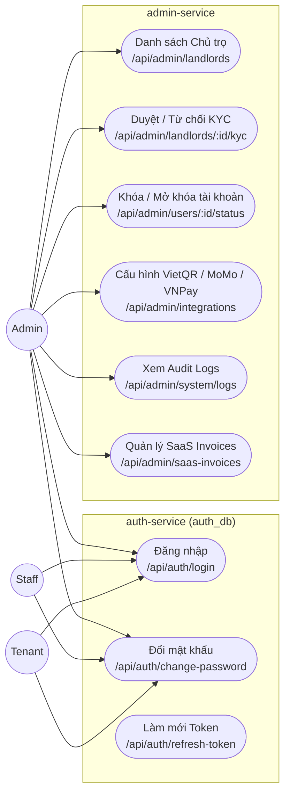

---

### 2.2 — property-service & room-service (Cơ sở & Phòng)

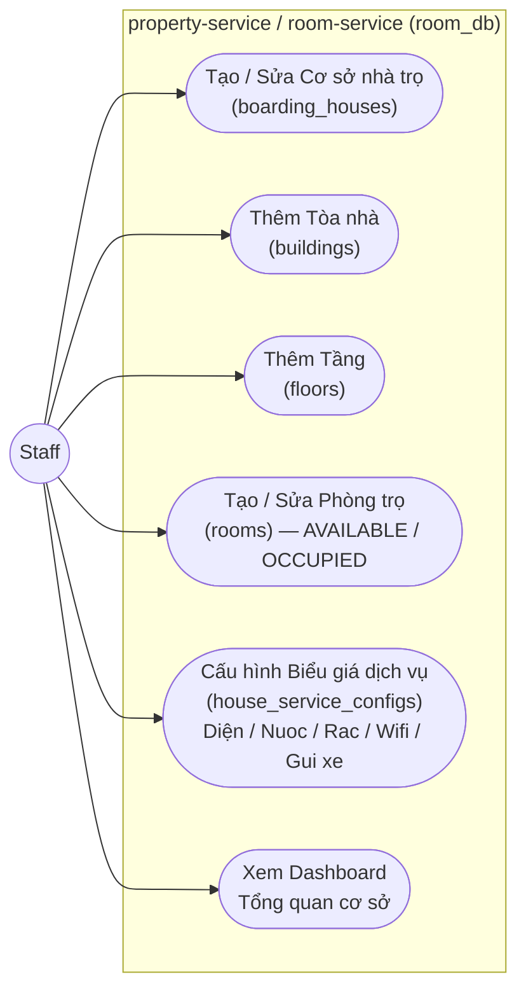

---

### 2.3 — tenant-service & contract-service (Khách thuê & Hợp đồng)

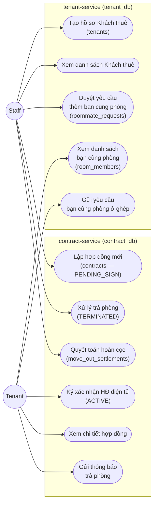

---

### 2.4 — meter-service & ai-service (Điện Nước & AI OCR)

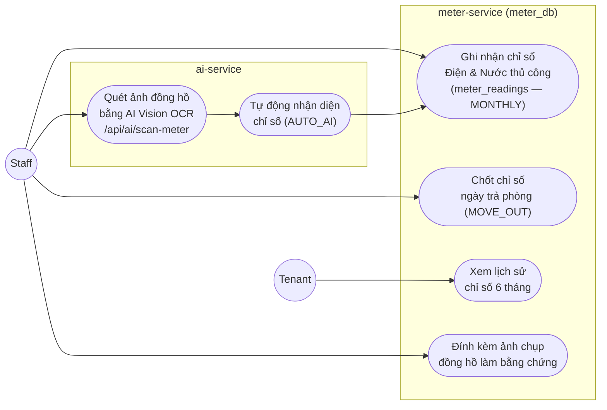

---

### 2.5 — billing-service & payment-service (Hóa đơn & Thanh toán)

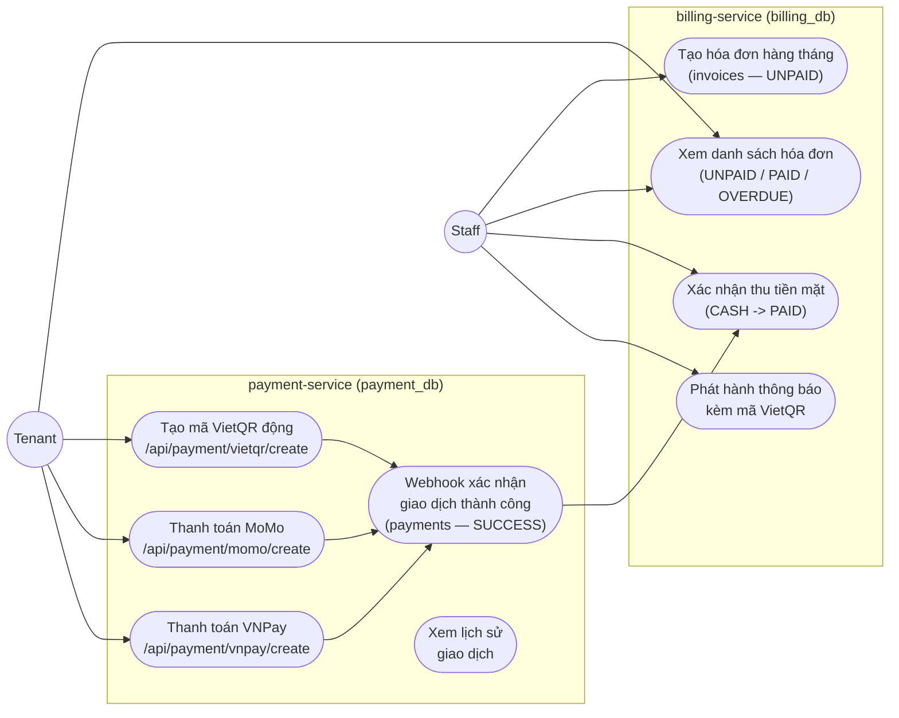

---

### 2.6 — maintenance-service (Bảo trì sửa chữa)

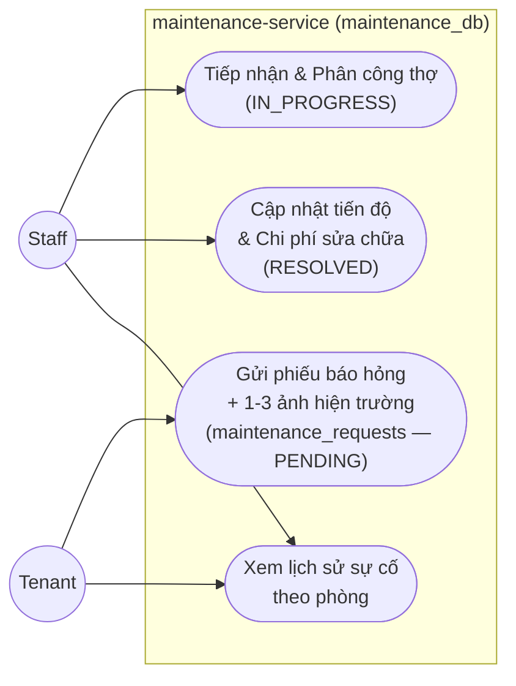

---

### 2.7 — report-service & notification-service (Báo cáo & Thông báo)

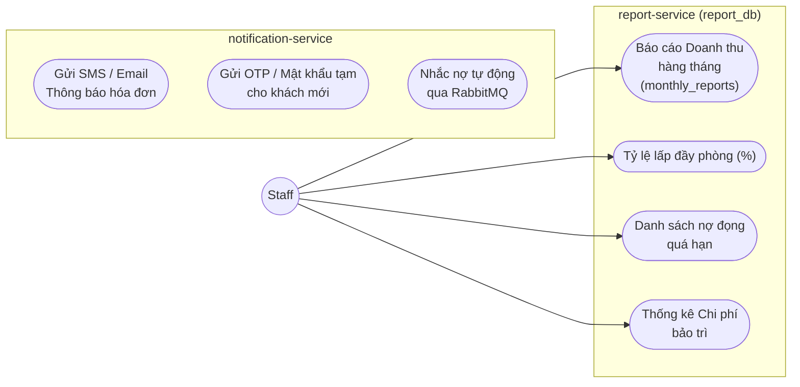

---

## 3. Bảng Danh mục Use Case Đầy đủ

### ADMIN — Quản trị nền tảng SaaS

| Ma UC | Ten chuc nang | Microservice | Route / Endpoint |
|:------|:-------------|:------------|:----------------|
| **UC-A01** | Quan ly Chu tro & Duyet KYC | `auth-service` | `/admin/landlords` |
| **UC-A02** | Cau hinh tich hop VietQR / MoMo / VNPay / AI / SMS | `api-gateway` / `payment-service` | `/admin/integrations` |
| **UC-A03** | Giam sat Microservices & Audit Logs | `discovery-server` | `/admin/system` |
| **UC-A04** | Quan ly SaaS Invoices | `billing-service` | `/admin/saas-invoices` |
| **UC-A05** | Khoa / Mo khoa tai khoan vi pham | `auth-service` | `/admin/users/:id/status` |

---

### STAFF — Vận hành cơ sở nhà trọ

| Ma UC | Ten chuc nang | Microservice | Page Frontend |
|:------|:-------------|:------------|:-------------|
| **UC-S01** | Thiet lap Co so, Toa nha, Tang, Phong | `room-service` / `property-service` | `BoardingHousesPage`, `RoomsPage` |
| **UC-S01B** | Cau hinh bieu gia dich vu co so | `room-service` | `BoardingHousesPage` |
| **UC-S02** | Tiep nhan khach, Lap hop dong & Nhan phong | `contract-service` + `tenant-service` | `TenantsPage` |
| **UC-S02B** | Duyet yeu cau them thanh vien o ghep | `tenant-service` + `auth-service` | `TenantsPage` |
| **UC-S03** | Ghi nhan & Chot chi so Dien Nuoc (AI/Tay) | `meter-service` + `ai-service` | `MetersPage` |
| **UC-S04** | Tinh hoa don & Thu tien phong | `billing-service` + `payment-service` | `InvoicesPage` |
| **UC-S05** | Tiep nhan & Dieu phoi bao tri sua chua | `maintenance-service` | `MaintenancePage` |
| **UC-S06** | Bao cao Doanh thu, Chi phi & Lap day | `report-service` | `ReportsPage` |
| **UC-S07** | Tra phong, Nghiem thu & Quyet toan cop | `contract-service` + `room-service` | `TenantsPage` |

---

### TENANT — Cổng Cư dân (Resident Portal)

| Ma UC | Ten chuc nang | Microservice | Ghi chu |
|:------|:-------------|:------------|:--------|
| **UC-T01** | Xem hop dong & Ky xac nhan dien tu | `contract-service` | e-sign |
| **UC-T02** | Tra cuu chi so dien nuoc & Doi soat anh | `meter-service` | Xem 6 thang gan nhat |
| **UC-T03** | Xem hoa don & Quet ma VietQR / MoMo / VNPay | `billing-service` + `payment-service` | Gach no tu dong 5-10s |
| **UC-T04** | Gui yeu cau Bao hong kem anh hien truong | `maintenance-service` | Chon muc uu tien |
| **UC-T05** | Xem danh sach ban cung phong (Mask CCCD) | `tenant-service` | An CCCD bao ve rieng tu |
| **UC-T06** | Gui thong bao Tra phong & Doi soat hoan cop | `contract-service` | Nhap STK nhan cop |
| **UC-T07** | Dang ky ban cung phong o ghep | `tenant-service` | Cho Staff duyet |

---

## 4. Kiến trúc Microservices — Tương quan với Use Case

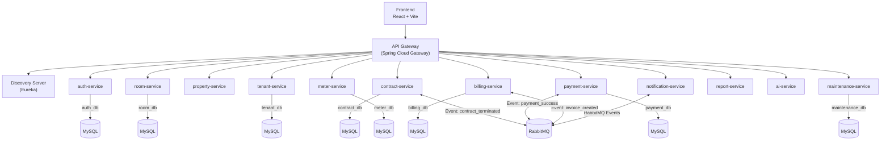

---

## 5. Nguyên tắc Phân quyền (Authorization Rules)

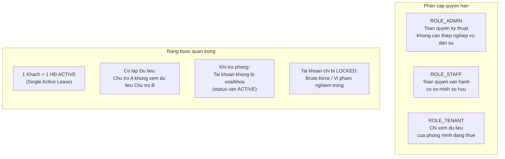

---

## 6. Luồng nghiệp vụ chính (Main Business Flows)

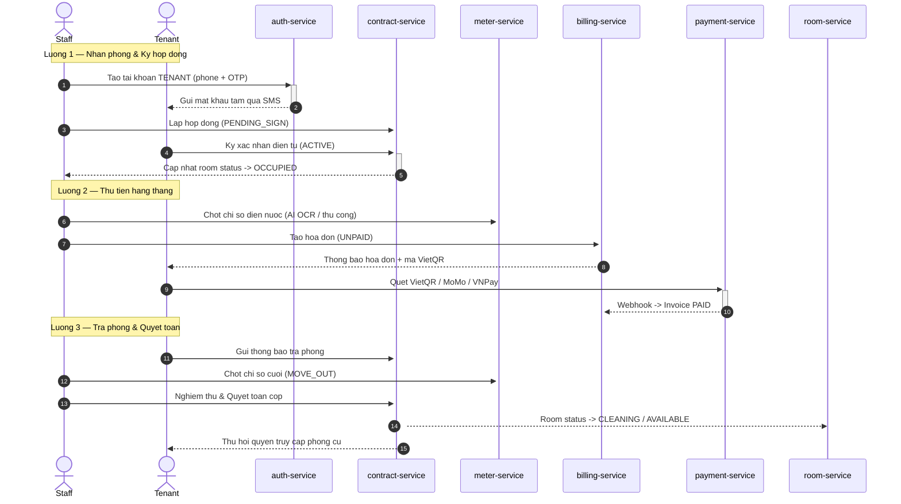
